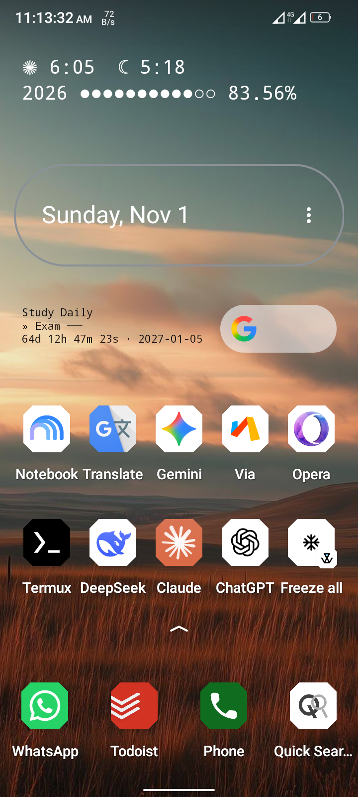
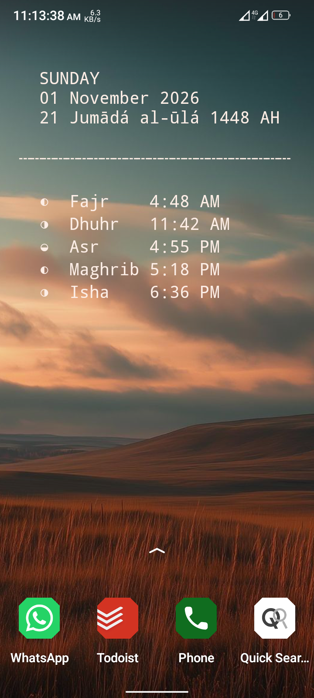

# widgets

A collection of text-based pretty cool widgets for Android, set via the Termux app on your home screen — built for Android nerds.

ANSI-colored terminal output, rendered directly as home screen widgets. No app store fluff, just pure shell & Node scripts you can read, tweak, and own.

<p align="center">
  
  
</p>

---

## Features

- **Date** — classic, minimal dotted, boxed, compact split
- **System** — battery + RAM in icon, bar, dotted, and label styles
- **Countdown** — configurable timer with bar, dotted, and label variants
- **Prayer Times** — compact, boxed grid, vertical, single-line (Node.js)
- **Year Progress** — progress bars with sun times, block aesthetic, circular, dot matrix, minimalist, retro terminal

---

## Setup

### 1. Install Termux

Get it from **F-Droid** (the Play Store version is outdated and broken):

> https://f-droid.org/packages/com.termux/

### 2. Install the Widget App

Install **Termux Terminal Widget**:

> https://apt.izzysoft.de/fdroid/index/apk/com.gardockt.termuxterminalwidget

### 3. Install Dependencies

Open Termux and run:

```bash
pkg update && pkg install bash curl jq nodejs git
```

Also install **Termux:API** for battery widgets:

```bash
pkg install termux-api
```

> You'll also need the **Termux:API** APK installed for `termux-battery-status` to work.

### 4. Clone This Repo

```bash
git clone https://github.com/fazle-rabbi-dev/yr-progress.git ~/widgets
cd ~/widgets
```

### 5. Add the Widget

1. Long-press an empty spot on your home screen
2. Select **Widgets**
3. Find and pick **Termux Terminal Widget**
4. Drag and drop it onto your home screen
5. In the widget's **command** field, enter one of the commands from the list below

---

## Widget Commands

Use these as the widget command (paths assume you cloned to `~/widgets`):

### Date

| Widget | Command |
|--------|---------|
| Classic | `bash ~/widgets/date/datetime1.sh` |
| Minimal Dotted | `bash ~/widgets/date/datetime2.sh` |
| Boxed | `bash ~/widgets/date/datetime3.sh` |
| Compact Split | `bash ~/widgets/date/datetime4.sh` |

### System (Battery + RAM)

| Widget | Command |
|--------|---------|
| Icon Row | `bash ~/widgets/system/system1.sh` |
| Bar Style | `bash ~/widgets/system/system2.sh` |
| Dotted Single Line | `bash ~/widgets/system/system3.sh` |
| Label Value | `bash ~/widgets/system/system4.sh` |

### Countdown

| Widget | Command |
|--------|---------|
| Classic | `bash ~/widgets/countdown/countdown1.sh` |
| Bar with % | `bash ~/widgets/countdown/countdown2.sh` |
| Minimal Dotted | `bash ~/widgets/countdown/countdown3.sh` |
| Label Value | `bash ~/widgets/countdown/countdown4.sh` |

### Prayer Times (Node.js)

| Widget | Command |
|--------|---------|
| Compact Inline | `node ~/widgets/prayer-time/prayer1.js` |
| Boxed Grid | `node ~/widgets/prayer-time/prayer2.js` |
| Vertical Minimal | `node ~/widgets/prayer-time/prayer3.js` |
| Single Line Dotted | `node ~/widgets/prayer-time/prayer4.js` |

### Year Progress

| Widget | Command |
|--------|---------|
| Sun Times + Progress | `bash ~/widgets/year-progress/combine.sh` |
| Boxed Symbols | `bash ~/widgets/year-progress/combine2.sh` |
| Gradient | `bash ~/widgets/year-progress/combine3.sh` |
| Segmented | `bash ~/widgets/year-progress/combine4.sh` |
| Block Aesthetic | `bash ~/widgets/year-progress/blockaesthetic.sh` |
| Circular | `bash ~/widgets/year-progress/circuler.sh` |
| Dot Matrix | `bash ~/widgets/year-progress/dotmatrix.sh` |
| Minimalist | `bash ~/widgets/year-progress/minimalist.sh` |
| Retro Terminal | `bash ~/widgets/year-progress/retroterminal.sh` |

---

## Configuration

### Countdown

Set your countdown target with:

```bash
bash ~/widgets/countdown/set-countdown.sh "Exam" "2027-01-05 00:00:00"
```

Or show the current one:

```bash
bash ~/widgets/countdown/set-countdown.sh
```

This writes to `countdown/.countdown.conf` — all countdown widgets read from it.

### Location (Sun / Prayer Times)

Edit the `LAT` / `LON` constants at the top of the relevant scripts:

```bash
LAT="24.75"   # Mymensingh
LON="90.40"
METHOD="1"    # Muslim World League
```

Files that use location:
- `year-progress/combine*.sh`
- `prayer-time/prayer*.js`

---

## Dependencies

| Tool | Purpose |
|------|---------|
| `bash` | All shell widgets |
| `awk` | Percentage / math formatting |
| `curl` + `jq` | Sun times API (Aladhan) |
| `node` v18+ | Prayer time widgets (uses global `fetch`) |
| `termux-api` | Battery status (Termux:API APK required) |
| Network | Aladhan API for sun/prayer times |

Install everything at once:

```bash
pkg install bash curl jq nodejs git termux-api
```

---

## Project Structure

```
widgets/
├── countdown/          # Countdown widgets + config
├── date/               # Date-only widgets
├── prayer-time/        # Prayer times widgets (Node.js)
├── system/             # Battery + RAM widgets
└── year-progress/      # Year progress widgets
```

---

## Customization

- All widgets output **2 lines** (prayer widgets may use more)
- Colors use ANSI escape codes — no external theme system
- Bar widths vary by widget (typically 8–15 segments)
- Percentages are formatted as decimals (e.g. `83.62%`)

Feel free to fork, recolor, and add your own variants.

---

## License

MIT — do whatever you want, just don't blame me if your home screen gets too pretty.
